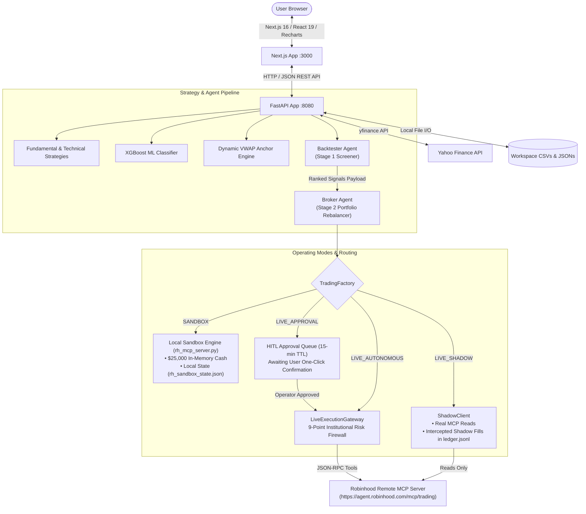
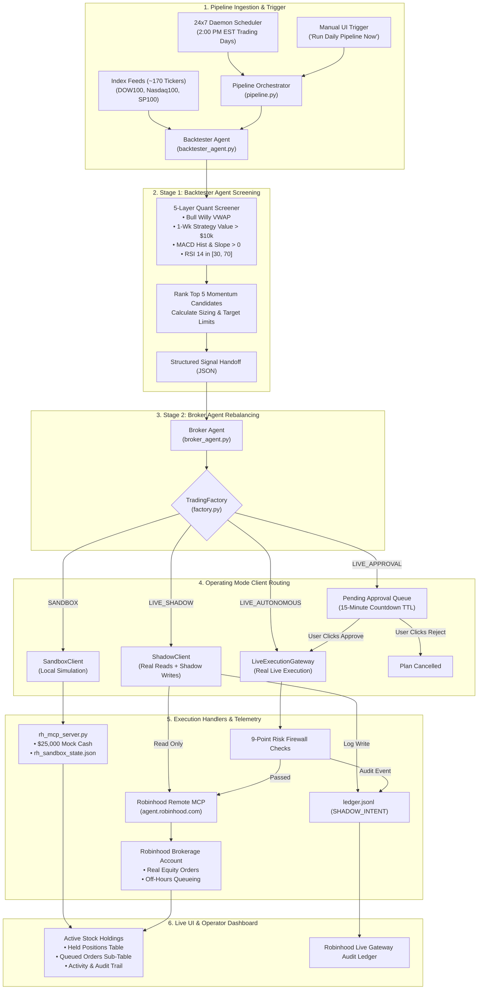

# Strategic Alpha Stock Picker Dashboard Documentation

The **Strategic Alpha Dashboard** is an institutional-grade, full-stack quantitative stock analysis platform. It integrates modern machine learning models, classical momentum indicators, and financial strategy models to evaluate equity tickers, backtest custom trading rules, simulate paper trading, and interface directly with broker gateways.

---

## 📋 1. Core Requirements

The application is engineered to meet the following functional and non-functional requirements:

### A. Real-Time Single-Ticker Evaluation
*   **11 Quantitative Strategy Models**: Calculate eligibility scores in real-time across 11 distinct investment methodologies (GARP, Pure Growth, CAN SLIM, Dividend Value, etc.).
*   **Justification Engine**: Dynamically synthesize human-readable explanations behind indicator calculations to provide transparent "Why" insights behind strategy matches.
*   **Machine Learning Integration**: Feed normalized ticker metrics into an XGBoost classifier model to output the probability of Alpha outperformance.
*   **Trend Visualization**: Render responsive 6-month historical price charts with overlays for technical review.

### B. Macroscopic Comparison & Backtesting
*   **Multi-Ticker Table**: Row-by-row visual comparison of all favorite or loaded tickers.
*   **Dynamic Sorting**: Sort tables on any strategy or ML score to easily rank assets.
*   **Willy VWAP Backtesting Engine**: Compute and compare the performance of the self-anchoring Willy VWAP strategy versus a passive "Buy & Hold" approach over a dynamic 4-month rolling window with initial capital of $10,000.
*   **Transaction Ledgers**: Generate a detailed chronological trade log for each backtest, tracking dates, actions (BUY/SELL), execution prices, shares, cash, and running portfolio values.

### C. Multi-Asset Compare Charts
*   **Normalized Baseline**: Chart multiple tickers on a relative performance index starting at a baseline of 100, enabling "apples-to-apples" comparison over multiple timeframes (1M, 3M, 6M, 1Y, 5Y).

### D. Technical Indicators & Advanced Charting
*   **Indicators Panel**: Display real-time computations of support/resistance bands, SMAs (9, 50, 200), EMA (20), RSI (14) with slopes, Bollinger Bands, and MACD.
*   **Automated Chart Capturing**: Standardize screenshot formatting using Playwright/Puppeteer with a 90% viewport scaling zoom factor to ensure no axis indicators or bottom oscillators are cropped.

### E. Paper Study & Simulation
*   **Multi-Portfolio Support**: Load custom CSV files from the workspace as active portfolios, with `localStorage` persistence.
*   **Real-Time Price Autofill**: Query `yfinance` to automatically populate current market prices on ticker input.
*   **Simulated Ledger**: Write transaction records (Date, Ticker, Quantity, Price, Total Cost, Running Cash) to persistent workspace CSV files while tracking real-time unrealized P&L.

### F. Broker Integration & Autonomous Agentic Trading
*   **Interactive Brokers Gateway**: Deprecated and decoupled in favor of the dedicated Robinhood Agentic Model Context Protocol (MCP) trading architecture.
*   **Robinhood Agentic Trading Engine & Model Context Protocol (MCP)**:
    *   **Four Multi-Environment Operating Modes**: Dynamic runtime switching between:
        1. **`SANDBOX`**: 100% in-process local Python simulation engine (`rh_mcp_server.py`) with $25,000 mock cash, simulated stock and option positions, and zero live financial risk.
        2. **`LIVE_SHADOW`**: Real account reads (`get_portfolio`, `get_equity_positions`, `get_equity_orders`, `get_equity_quotes`) via Robinhood MCP with simulated shadow order execution logged to `_data/live_trading/ledger.jsonl`.
        3. **`LIVE_APPROVAL`**: Human-In-The-Loop (HITL) institutional governance. Automated AI rebalancing generates a proposed plan queued in a 15-minute countdown buffer for manual review (`Approve & Execute via Live Gateway` vs. `Reject Plan`).
        4. **`LIVE_AUTONOMOUS`**: Fully automated, hands-free live execution of pipeline signals directly through the Robinhood Trading MCP server (`place_equity_order`), protected by a safety confirmation passphrase (`I UNDERSTAND THIS TRADES REAL MONEY`).
    *   **Autonomous Multi-Agent Workflow**: Dual-agent pipeline featuring the **Backtester Agent** (analyst scanning ~170 constituent tickers from Dow 30, Nasdaq 100, and S&P 500 daily at 2:00 PM EST) and **Broker Agent** (portfolio comparator and execution manager).
    *   **9-Point Institutional Risk Firewall**: Mandatory pre-trade safety checks in `LiveExecutionGateway` (Kill switch, NYSE session status with off-hours queue allowance, equities-only policy, single-position cap, daily spend ceiling, PDT protection, fresh quote spread validation, LIMIT DAY order constraints, and deterministic client order ID idempotency).
    *   **Live Order & Queued Orders Telemetry**: Real-time tracking of active stock holdings and off-hours queued orders awaiting market open, synced directly with Robinhood MCP.

### G. Benchmark Index Comparative Analysis (Top Tickers)
*   **Index Multi-Select Support**: Load and compare constituents of major benchmark indices (`DOW100.csv` / Dow 30, `Nasdaq100.csv` / Nasdaq 100, and `SP100.csv` / S&P 500) using a multi-select toggle layout.
*   **Set Union Merging**: Add/remove index selections dynamically, automatically performing a set union of all tickers across the selected indices.
*   **Safe Chunked Loading**: Fetch analysis data in small, background-loaded consecutive chunks of 10 tickers to avoid Yahoo Finance query timeouts.
*   **Quantitative Screener**: Execute a 5-layer screen filtering matching symbols (Willy Market = Bull, 1-mo backtest strategy value > $10,000, MACD Hist within ±0.5, MACD Slope > 0, and RSI between 30 and 70) and save candidates to `Top_Tickers_to_buy.csv` in the project root.

---

## 🎨 2. Design Factors & Aesthetics

The design of the application prioritizes visual excellence and ergonomic efficiency:

*   **Aesthetic Glassmorphism UI**: Uses a premium, dark-mode optimized color palette. Cards and widgets feature translucent backgrounds with thin borders, backdrop blurs, and neon accents to resemble a modern trading desk terminal.
*   **Color-Coded Feedback**: Match percentages are styled dynamically—Green for strong matches ($\ge$ 75%), Yellow for moderate matches (40-74%), and Red for weak matches (< 40%)—ensuring readability.
*   **Sticky Ticker Column**: Lock target stock identifiers to the left edge of comparison grids to maintain context when scrolling horizontally through complex data sets.
*   **Performance Optimization**: Utilizes parallel API requests, history caching, and batch query endpoints to keep UI rendering latency below 700ms.

---

## 🏛️ 3. General Design & Architecture



### A. Dynamic Self-Anchoring VWAP (WillyAlgo)
Unlike a standard daily-reset VWAP, the **WillyAlgo** dynamically detects market structure changes using a swing pivot detection algorithm (configured with a default 5-bar window). The moment a significant swing high or low is reached, the VWAP anchors reset to 0, tracking volume fair value from the pivot forward.

### B. Viewport Scaling Optimization
For automated portfolio reports, a dedicated script uses Chromium to capture technical charts. The viewport is styled with a `90%` zoom factor to ensure all bottom indicators, MACD labels, and legends are captured without cropping.

---

## 💻 4. Implementation Details

### A. Technical Stack
*   **Backend**: Python, FastAPI, Uvicorn, `yfinance` (Data Fetcher), `xgboost` & `scikit-learn` (Predictive Models), `ib_insync` (IBKR Bridge).
*   **Frontend**: Next.js 16, React 19, TypeScript, Recharts (Responsive Charting), Tailwind CSS (Glassmorphism design system).
*   **Dev-Ops/Execution**: Python Virtual Environment (`.venv`), Node Package Manager (Webpack bundler mode to ensure compatibility with Node v24).

### B. Core File Structure
*   [`backend/main.py`](file:///c:/Users/moder/AntiGravity/StockPickerStrategies-20260610/backend/main.py): Primary REST API containing endpoints for analysis, backtests, raw data, paper simulation, reports, and IB configuration.
*   [`backend/models.py`](file:///c:/Users/moder/AntiGravity/StockPickerStrategies-20260610/backend/models.py): Pydantic schema schemas mapping the data structures.
*   [`backend/strategies/`](file:///c:/Users/moder/AntiGravity/StockPickerStrategies-20260610/backend/strategies): Python modules evaluating individual strategy parameters (e.g., `can_slim.py`, `willy_algo.py`, `machine_learning.py`).
*   [`backend/services/strategy_engine.py`](file:///c:/Users/moder/AntiGravity/StockPickerStrategies-20260610/backend/services/strategy_engine.py): Main coordinator running the ticker metrics through all strategy models.
*   [`frontend/src/components/`](file:///c:/Users/moder/AntiGravity/StockPickerStrategies-20260610/frontend/src/components): React widgets (e.g., `AnalysisPanel.tsx`, `BacktestDetails.tsx`).

---

## 🚀 5. How to Use the Application

### A. Local Setup & Execution

#### 1. Start the Backend (FastAPI)
Navigate to the `backend/` directory, activate the Python virtual environment, and boot the server using Uvicorn:
```bash
cd backend
.venv\Scripts\activate
python -m uvicorn main:app --host localhost --port 8080
```
Verify the server status by visiting [http://localhost:8080/health](http://localhost:8080/health) (should return `{"status":"ok"}`).

#### 2. Start the Frontend (Next.js)
Navigate to the `frontend/` directory and boot the development server in Webpack mode:
```bash
cd frontend
npx next dev --webpack
```
Open [http://localhost:3000](http://localhost:3000) in your web browser.

---

### B. Interface Guide & Features

#### 1. Single Ticker Dashboard
*   **Action**: Enter a stock ticker (e.g., `AAPL`, `NVDA`) in the search bar and press enter.
*   **Insight**: The interface displays a 6-month historical trend line alongside the **Quant Factors Breakdown** panel showing dynamic percentages and justification cards. The **ML Alpha Probability** panel reports the predicted likelihood of outperforming the benchmark.


#### 2. Portfolio Comparison & Backtesting
*   **Action**: Toggle to the *Comparison* tab to view the list of tracked tickers. Click on columns to sort them.
*   **Willy VWAP Backtest**: Select any ticker in the table to open the detailed backtest drawer. It simulates the self-anchored Willy VWAP trading rule over a rolling 4-month window, plotting the equity curve (Strategy vs. Buy & Hold) and generating a full transaction ledger.


#### 3. Relative Performance (Compare Charts)
*   **Action**: Click the *Compare Charts* tab.
*   **Insight**: Select multiple tickers to view their indexed performance. All selected stocks start at a baseline of `100` at the beginning of the timeframe, letting you compare percentage growth directly.


#### 4. Technical Indicators
*   **Action**: Open the *Technical Indicators* tab.
*   **Insight**: Inspect short and long-term Moving Averages (9, 50, 200), Bollinger Bands, RSI momentum curves, and MACD histograms.


#### 5. Advanced Charts
*   **Action**: Access the *Advanced Charts* screen.
*   **Insight**: View high-resolution TradingView-style charts. This view is optimized for Playwright captures, rendering bottom oscillators perfectly at a 90% zoom ratio.


#### 6. Raw Data Exploration
*   **Action**: Select the *Raw Data* tab.
*   **Insight**: Explore the raw financial payload (150+ metrics) directly parsed from `yfinance`, categorized by valuation, profile, trading, and balance sheet metrics.


#### 7. Strategy Glossary
*   **Action**: Open the *Glossary* tab.
*   **Insight**: View the mathematical references, formulas, and metric boundaries for every strategy in the engine, including the exact hyperparameters of the XGBoost classifier.


#### 8. Paper Study Simulation
*   **Action**: Toggle to the *Paper Study* page.
*   **Insight**: Run paper transactions. Enter a ticker to auto-fill its current price, select transaction type (Buy, Sell, Deposit, Withdraw), and input quantities. The local ledger updates instantly, displaying current cash, active holdings, and unrealized profit.


#### 9. Broker Gateway
*   **Action**: Select the *Brokers* tab.
*   **Insight**: Log in with your Interactive Brokers gateway credentials. The screen retrieves your real-time buying power, net liquidation value, active orders, and live positions from TWS/IB Gateway.


#### 10. Top Tickers Analysis & Buy Screener
*   **Action**: Select the *Top Tickers* tab. Click to toggle selection for **Dow 30**, **Nasdaq 100**, and **S&P 500**.
*   **Screener Action**: Click the **Run Buy Screen** button. View the list of matching candidates in the glassmorphic container, then click **Save to Top_Tickers_to_buy.csv** to output the buy list to the workspace.


#### 11. Options Backtesting Engine & P&L Analytics
*   **Action**: In the *Top Tickers* tab, locate the **Options Strategy Row**.
*   **Configuration**:
    *   Select your lookback timeframe (**1W**, **1M**, **3M**, **6M**, **1Y**).
    *   Choose an **Options Exit Strategy**:
        *   **T+2, T+3, T+5, T+7, T+10, T+12, T+14, T+21 Intraday**: Exits positions at 11:00 AM NY time with synthetic Black-Scholes re-pricing based on remaining DTE.
        *   **Hold to Expiry**: Holds positions to weekly expiration (~7 calendar days) and settles at intrinsic value $\max(S_{exit} - K, 0)$.
*   **Execution & Pricing**:
    *   Screens top 5 candidates daily via Strategy 1 (Willy Bull, 1-Wk Value > $10k, MACD Hist, MACD Slope > 0, RSI 30-70).
    *   Simulates buying At-The-Money (ATM) Calls at T+1 3:00 PM priced via Black-Scholes with 30-day realized volatility and 5% risk-free rate.
    *   Positions sized with $2,000 per ticker ($10,000 maximum daily allocation).
*   **Analyzing Results**:
    *   **Options P&L ($ & %)**: Total dollar profit and ROI across the period.
    *   **Hold to Expiry Baseline**: Measures passive holding vs. active intraday exit profit capture.
    *   **Relative Performance Denominator**: $\frac{\text{Strategy P\&L} - \text{Hold P\&L}}{|\text{Hold P\&L}|} \times 100\%$ isolates the exact alpha generated by exit timing.
    *   **S&P 500 Benchmark**: Quantifies excess leveraged alpha over the broad market.
    *   **Options Trade Ledger**: Inspect per-contract strikes, entry/exit premiums, leverage multiples, and export full logs to `Backtest_Ledger_Options.csv`.

#### 12. Specialized AI Agents, Operating Modes & Robinhood MCP Pipeline
*   **Action**: Select the *Brokers* tab and choose **Robinhood Agentic AI**.

##### A. Dual Agent Architecture
The agentic trading system decouples **market analysis** from **capital execution** into two specialized agents:
1.  **Backtester Agent (Stage 1 Screener & Quant Analyst)**:
    *   **24x7 Daemon Scheduler**: Background thread monitoring `America/New_York` market time, automatically triggering every trading day at **2:00 PM EST/EDT**.
    *   **Universe Scan**: Evaluates all ~170 constituent tickers across the **Dow 30**, **Nasdaq 100**, and **S&P 500**.
    *   **5-Layer Strategy 1 Screen**:
        1.  *Willy Bull Market State*: Price strictly above the self-anchored dynamic VWAP.
        2.  *1-Week Strategy Value*: Backtest strategy value exceeds $10,000 threshold.
        3.  *MACD Histogram Stability*: Histogram bounded within $[-0.5, 0.5]$.
        4.  *MACD Slope Health*: Positive slope ($\Delta \text{MACD} > 0$).
        5.  *RSI Momentum Envelope*: 14-period RSI bounded within $(30, 70)$.
    *   **Signals Generated**: Selects top 5 ranked assets and outputs target share quantities, limit prices, and ATM Call option parameters.
2.  **Broker Agent (Stage 2 Portfolio Rebalancer & Execution Manager)**:
    *   **Portfolio Analysis**: Compares current account holdings against incoming Stage 1 recommendations.
    *   **Dynamic Liquidation & Sizing**: Automatically liquidates displaced/non-strategy holdings to free up cash. Computes effective buying power as:
        $$\text{Effective Buying Power} = \text{Available Cash} + \sum \text{Sell Liquidation Proceeds}$$
    *   **Execution Routing**: Delegates execution to the appropriate client implementation resolved by `TradingFactory` based on the active **Operating Mode**.

---

##### B. The Four Operating Modes Explained

The platform provides 4 runtime operating modes, allowing operators to seamlessly transition from zero-risk offline simulation to fully autonomous live execution:

| Operating Mode | Environment Used | Connects to Robinhood MCP? | Real Money at Risk? | Order Execution Behavior |
| :--- | :--- | :--- | :--- | :--- |
| **🛡️ SANDBOX** | **Local Sandbox Simulator** | ❌ **NO** (100% Offline / Local) | **$0.00** (0% Risk) | Executes against internal in-memory Python engine (`rh_mcp_server.py`) with **$25,000 simulated cash**. Supports simulated stocks and options. |
| **👁️ LIVE_SHADOW** | **Hybrid** (Real Reads, Mock Writes) | ✅ **YES (Reads Only)** | **$0.00** (0% Risk) | Reads your real Robinhood balance, positions, and live quotes via MCP. Order placements are intercepted and recorded to `ledger.jsonl` without sending real orders. |
| **⏳ LIVE_APPROVAL** | **Robinhood Live MCP + HITL** | ✅ **YES (Reads & Approved Orders)** | ⚠️ **REAL MONEY** (Operator Gated) | Automated AI rebalance plans are queued in a **Pending Approval** card (15-min TTL). Orders are sent to Robinhood only when you click **Approve** (or execute from Playground). |
| **⚡ LIVE_AUTONOMOUS** | **Robinhood Live MCP Autonomous** | ✅ **YES (Full Live Execution)** | 🚨 **REAL MONEY** (Hands-Free) | Pipeline dispatches real stock orders directly to Robinhood MCP without waiting for manual clicks, guarded by the 9 safety firewall checks. |

*   **Mode Switching**: Switch modes anytime via the UI Operating Mode buttons or `POST /api/trading/mode`.
*   **Autonomous Safeguard**: Engaging `LIVE_AUTONOMOUS` mode requires entering the mandatory confirmation phrase: `"I UNDERSTAND THIS TRADES REAL MONEY"`.
*   **Sandbox Isolation**: The local Sandbox simulator is completely isolated from live brokerage requests. It maintains independent state in `rh_sandbox_state.json` with a dedicated **Reset Sandbox** button to restore initial $25,000 cash.

---

##### C. 9-Point Institutional Risk Firewall (`LiveExecutionGateway`)

In all live modes (`LIVE_APPROVAL`, `LIVE_AUTONOMOUS`, `LIVE_SHADOW`), orders must pass through the institutional firewall implemented in [`backend/trading/live_gateway.py`](file:///d:/AI/StockPickerStrategies/backend/trading/live_gateway.py):

1.  **Check 1: Emergency Kill Switch & Circuit Breaker**: Trading halts instantly if the kill switch is engaged or if 3 consecutive API execution failures trip the circuit breaker.
2.  **Check 2: Market Session & Broker Rest Window**: Validates regular NYSE trading hours (9:30 AM - 4:00 PM ET) and enforces a broker rest blackout (11:30 AM - 1:55 PM ET). Orders placed outside regular hours are safely transmitted to Robinhood and queued for market open.
3.  **Check 3: Equities-Only Live Policy**: Live execution is restricted to equities; synthetic options and crypto are safely skipped.
4.  **Check 4: Single-Position Cap & Duplicate Guard**: Enforces the maximum portfolio concentration limit (default: 15% equity cap) while permitting single-share odd-lot testing.
5.  **Check 5: Buying Power & Daily Spend Cap**: Verifies that order costs do not exceed available cash, the remaining daily budget (default: $5,000/day), or the maximum daily drawdown limit (< 2%).
6.  **Check 6: Held Quantity & Pattern Day Trader (PDT) Guard**: Validates that sell orders do not exceed sellable shares and prevents day-trading buys executed on the same calendar day.
7.  **Check 7: Fresh Quote Validation**: Verifies that live bid-ask spreads do not exceed 0.50% and price deviations from the signal price remain within $\pm 1.0\%$.
8.  **Check 8: Order Constraints**: Enforces `LIMIT`, `DAY`, and regular-session order types with dynamic price rounding buffers.
9.  **Check 9: Deterministic Idempotency & Audit Trail**: Generates unique client order IDs (`UUIDv4`) to eliminate duplicate order execution and appends full telemetry to `_data/live_trading/ledger.jsonl`.

---

##### D. End-to-End Execution Flow



---

##### E. Operator UI & Telemetry Components

1.  **Active Stock Holdings Card**:
    *   **Dynamic Data Switching**: Automatically displays simulated positions in `SANDBOX` mode, or live equity holdings fetched from Robinhood MCP in `LIVE` modes.
    *   **Orders Queued for Market Open**: Detects and displays orders placed during weekends or after-hours (`VZ`, `NVDA`, `F`), showing ticker, quantity, limit price, execution status (`QUEUED`), timestamp, and Robinhood Order IDs.
    *   **Header Badges**: Highlights active position counts (e.g., `0 Held · 3 Queued`) with status indicators.
2.  **Execution Playground**:
    *   **Ad-Hoc Order Execution**: Push manual BUY/SELL orders directly to the local Sandbox simulator or to your Robinhood MCP trading account.
    *   **Mode-Independent Button**: Unified **`EXECUTE ORDER`** action button with instant visual feedback and kill-switch locks.
    *   **Pre-Check / Dry Run**: Pre-trade order verification tool calling Robinhood's `review_equity_order` to inspect real bid/ask quotes and market disclosures before submitting real orders.
3.  **Robinhood Live Gateway Audit Ledger**:
    *   Displays real-time append-only records from `_data/live_trading/ledger.jsonl`.
    *   Logs every pre-flight firewall decision, execution fill, reject reason, shadow intent, and human approval event.

#### 13. Call Option Stats Matrix & Trend Metrics
*   **Action**: Click the **Call Option Stats Matrix** button on the Top Tickers view or open the modal.
*   **Multi-Period Ordinary Least Squares (OLS) Linear Fit**:
    *   Configurable timeframes (`1Wk`, `2Wk`, `4Wk`, `6Wk`, `3 months`, `6 months`) dynamically calculating linear slope ($m$) and residual standard deviation ($\text{Std}$).
*   **Normalized Trend Metrics**:
    *   **Slope %**: $\text{Slope \%} = \frac{\text{Slope}}{\text{Price}} \times 100\%$ — Normalized percentage drift rate per day.
    *   **Std %**: $\text{Std \%} = \frac{\text{Std Dev}}{\text{Price}} \times 100\%$ — Normalized percentage price volatility envelope.
    *   **Trend Score**: $\text{Trend} = \frac{\text{Slope \%}}{\text{Std \%}}$ — Quantifies the signal-to-noise ratio of directional momentum, highlighting clean trend breakouts suitable for Call Option entries.

#### 14. Slope % Ranked Call Options Backtesting Engine (1-Week & 2-Day Holding)
*   **Action**: On the Top Tickers panel, select the **Slope % (1-Week Hold)** or **Slope % (2-Day Hold)** Backtest tabs.
*   **Core Mechanics**:
    *   **Screening**: Filters constituents across Dow 30, Nasdaq 100, and S&P 500 on Day $T$ for positive Slope % ($m > 0$), RSI, MACD, and Volume health.
    *   **Candidate Ranking**: Ranks eligible tickers by descending Slope % over the selected OLS lookback window (`1Wk`, `2Wk`, `4Wk`, `6Wk`, `3M`, `6M`).
    *   **Execution Models**:
        *   **1-Week Hold**: Enters 1-Month ATM Call options on Day $T+1$ (Open) and exits 1 week later (Day $T+5$ Close).
        *   **2-Day Hold**: Enters 1-Month ATM Call options on Day $T+1$ (Open) and exits 2 trading days later (Day $T+3$ Close) to capture immediate breakout momentum.
    *   **Ledger & Analytics**: Displays day-by-day strike, expiration, premium leverage multiple, Slope %, Std %, and Trend score metrics with Dow, S&P 500, and NASDAQ benchmark comparisons.


