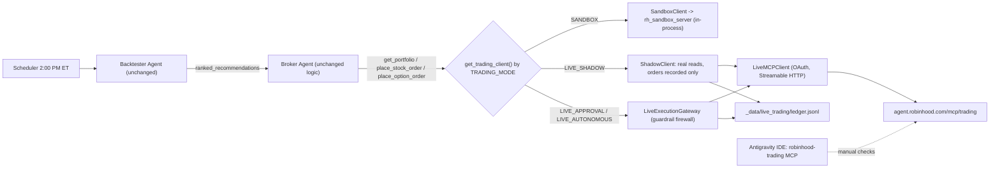

# Robinhood MCP Live Trading — Implementation Plan

**Goal:** Let the Broker Agent trade the real Robinhood **Agentic (MCP) account** through
`https://agent.robinhood.com/mcp/trading`. The Sandbox stays in place for internal testing.
**Constraint:** The Backtester Agent and Broker Agent keep the same **inputs, strategy, sizing logic, and output schema**.

## Decisions Locked In

| # | Decision | Choice |
|---|---|---|
| 1 | Broker rest window | Moved to **11:30 AM – 1:55 PM ET**. The Broker trades right after the 2:00 PM backtest |
| 2 | Options in Live | **Equities only**. Option signals are logged as `SKIPPED_LIVE_POLICY`. Sandbox still trades options |
| 3 | Approval model | **Phased**: `LIVE_SHADOW` → `LIVE_APPROVAL` → `LIVE_AUTONOMOUS` |
| 4 | Connectivity | **Both**: an unattended Python OAuth MCP client for the scheduler, plus the IDE `robinhood-trading` MCP for manual checks |
| 5 | Adding to held positions | **Guardrail wins**. In Live, buying a symbol you already hold is logged as `SKIPPED` |

---

## 1. Review of the Current Implementation

### 1.1 Plugin / customization layer

| Severity | Finding | Location |
|---|---|---|
| 🔴 Critical | Both plugin folders declare `"name": "robinhood-agentic-trading"`. The **sandbox** folder wins, so the Live rules and skill **never load** | [agentic-trading/plugin.json](file:///d:/AI/StockPickerStrategies/.agents/plugins/agentic-trading/plugin.json), [robinhood-agentic-trading/plugin.json](file:///d:/AI/StockPickerStrategies/.agents/plugins/robinhood-agentic-trading/plugin.json) |
| 🔴 Critical | The **sandbox** plugin's `mcp_config.json` also exposes the **live** `robinhood-trading` server. Sandbox testing could reach real money | [agentic-trading/mcp_config.json](file:///d:/AI/StockPickerStrategies/.agents/plugins/agentic-trading/mcp_config.json) |
| 🟠 High | `ROBINHOOD_ENV` / `ROBINHOOD_ACCOUNT` env vars on the remote MCP do nothing. `mcp-remote` ignores them, and Robinhood picks the account from your **OAuth login**, not an env var | [robinhood-agentic-trading/mcp_config.json](file:///d:/AI/StockPickerStrategies/.agents/plugins/robinhood-agentic-trading/mcp_config.json) |
| 🟠 High | The real account number is committed in `.agents/` (not gitignored) | same |
| 🟠 High | Timing contradiction: Backtester at 2:00 PM vs Broker rest 11:30–3:45 → *(resolved by Decision 1)* | [SKILL.md](file:///d:/AI/StockPickerStrategies/.agents/plugins/robinhood-agentic-trading/skills/automated-trading-pipeline/SKILL.md) |
| 🟡 Medium | Server name used inconsistently: `rh-trading`, `robinhood-mcp`, `robinhood-trading` | SKILL.md |
| 🟡 Medium | The live guardrails still say "record in the **sandbox ledger**". The `.agent_state/active_trades.json` path it mentions doesn't exist | trading_guardrails.md / SKILL.md |
| 🟡 Medium | `robinhood-local` runs the sandbox server with `ROBINHOOD_ENV=LIVE`. The server actually reads `ROBINHOOD_ENVIRONMENT`, so it stays sandbox. The name is misleading | agentic-trading/mcp_config.json |
| ⚪ Low | `mcp_config_old.json` runs `python mcp-remote`, which is broken. Recommend deleting it | agentic-trading/ |

### 1.2 Backend

| Severity | Finding | Location |
|---|---|---|
| 🔴 Critical | `RobinhoodLiveClient` calls a **made-up REST API** (`api.robinhood.com/api/v1/orders/` with HMAC headers). That is not Robinhood's agentic interface; the official path is the OAuth MCP | [rh_live_client.py](file:///d:/AI/StockPickerStrategies/backend/services/rh_live_client.py) |
| 🔴 Critical | With demo keys (the default), "live" orders return a **fake `FILLED`**. This breaks your *no fabricated confirmations* rule | [rh_live_client.py:156-173](file:///d:/AI/StockPickerStrategies/backend/services/rh_live_client.py#L156-L173) |
| 🔴 Critical | The live branch treats "order accepted" as "filled", and uses `time_in_force: gtc`, so a stale limit order could fill days later | [rh_mcp_server.py:361-389](file:///d:/AI/StockPickerStrategies/backend/mcp/rh_mcp_server.py#L361-L389) |
| 🟠 High | The `backend/mcp/` package **hides the official `mcp` Python SDK**, because `BACKEND_DIR` is inserted at `sys.path[0]`. The real MCP client can't be imported until it's renamed | [backend/mcp/](file:///d:/AI/StockPickerStrategies/backend/mcp) |
| 🟠 High | `BrokerAgent` hard-wires `RobinhoodMCPClient()`, which only talks to the in-process sandbox | [broker_agent.py:28](file:///d:/AI/StockPickerStrategies/backend/agents/broker_agent.py#L28) |
| 🟡 Medium | Report labels are hardcoded: `"environment": "ROBINHOOD_MCP_SANDBOX"`, `"CONNECTED_SANDBOX"` | broker_agent.py:354, pipeline.py:246 |
| 🟡 Medium | The scheduler skips weekends but **not market holidays** | [pipeline.py:87](file:///d:/AI/StockPickerStrategies/backend/agents/pipeline.py#L87) |

---

## 2. Target Architecture



**Core idea:** everything switches at the **client layer**. The Broker Agent keeps calling the same three methods,
with the same arguments and the same return shape. A factory decides whether those calls go to the sandbox, a shadow recorder,
or the live gateway. **The Broker's only change is one constructor line.**

---

## 3. Implementation Work Breakdown

### Phase 0 — Customization hygiene *(done in this change, see §6)*
- Make plugin names unique. Remove live servers from the sandbox plugin. Remove the ineffective env vars and the committed account number.
- Rewrite the Live guardrails and Live skill. Mark the sandbox plugin as internal-testing-only.

### Phase 1 — Backend refactor (no behavior change)
1. **Rename `backend/mcp/` → `backend/rh_sandbox/`** so the official `mcp` SDK can be imported.
   - Update imports in `broker_agent.py`, `main.py`, and `mcp/__init__.py` (import lines only).
   - Update the sandbox plugin `mcp_config.json` path → `backend/rh_sandbox/rh_mcp_server.py`.
2. **Create `backend/trading/` package:**
   - `client_protocol.py` — `TradingClient` Protocol with `environment`, `get_portfolio()`, `place_stock_order(symbol, action, quantity, price)`, `place_option_order(...)`, using **the exact signatures and return dicts used today**.
   - `sandbox_client.py` — today's `RobinhoodMCPClient`, renamed. Sets `environment = "ROBINHOOD_MCP_SANDBOX"`.
   - `factory.py` — `get_trading_client()` reads `TRADING_MODE` (`SANDBOX` default).
3. **BrokerAgent (only change):** `self.client = get_trading_client()`. Report `environment` comes from `self.client.environment`.
4. **Hard-disable the old LIVE branch** in the sandbox server, so that server can only ever simulate.
   Deprecate `rh_live_client.py` (keep the file, raise `NotImplementedError` on order methods).
5. **Regression:** run the sandbox pipeline before and after the refactor. The Broker JSON output must match (except timestamps).

### Phase 2 — Live MCP connectivity
1. Add `mcp>=1.10` (official Python SDK) to `backend/requirements.txt`.
2. `backend/trading/live_auth.py` — OAuth 2.1 + PKCE using the SDK's `OAuthClientProvider`:
   - Run once: `python -m trading.live_auth login` opens the browser for Robinhood login. **This is where Robinhood asks you to open or select the MCP account.**
   - Tokens are stored **outside the repo** at `%USERPROFILE%\.strategicalpha\robinhood_oauth.json` (file permissions limited to the current user).
   - Refresh happens automatically. If refresh fails, trip the circuit breaker and send an email alert (reuse the existing SMTP settings).
3. **Tool discovery (required, no guessing):** `python -m trading.live_auth tools` → write `tools/list` to
   `docs/robinhood_mcp_tools.json`. Then fill in `backend/trading/rh_tool_map.py`, which maps logical operations
   (`get_account`, `get_positions`, `get_quote`, `place_equity_order`, `get_order`, `cancel_order`) to the real tool names and argument schemas.
   > Robinhood's public article lists tool *categories* only (Account/portfolio, Watchlist, Market data, Equities, Options, Crypto). Exact names must come from `tools/list`.
4. `backend/trading/live_client.py` — `LiveMCPClient` (Streamable HTTP session, timeouts, retry with backoff for **read** calls only).
5. **Portfolio normalizer:** turn the MCP account + positions data into the dict shape the Broker already reads:
   `cash_available` (= buying power from MCP), `holdings[{symbol, quantity, current_price, avg_price, market_value, unrealized_pnl}]`,
   `option_positions`, `total_equity`, `guardrails{daily_spend_limit, today_spend_total, remaining_daily_budget, position_cap_pct}`.
   The guardrails values are computed locally from the live ledger.
6. **Account pinning:** on connect, check that the MCP-reported agentic account matches `ROBINHOOD_AGENTIC_ACCOUNT_NUMBER` in `.env`. If not, refuse to trade.

### Phase 3 — Live Execution Gateway (guardrail firewall)
`backend/trading/live_gateway.py` wraps `LiveMCPClient` and runs these checks **for every order** (full text in the updated rules):

| Order | Check | On fail |
|---|---|---|
| 1 | Kill switch off, mode allows submission, circuit breaker closed | Reject all |
| 2 | Regular market session open; Broker not in the 11:30–13:55 ET rest window; not a market holiday | Reject |
| 3 | Equity only (no option or crypto symbols) | `SKIPPED_LIVE_POLICY` |
| 4 | BUY: symbol not already held | `SKIPPED` (Position Limit) |
| 5 | BUY: within buying power, daily spend limit, 15% position cap; intraday drawdown < 2% | Reject |
| 6 | SELL: quantity ≤ held quantity; position not opened today (protects against Pattern Day Trader limits) | Reject |
| 7 | Fresh MCP quote: spread ≤ 0.50%; signal price within ±1.0% of mid (stale-signal guard) | `SKIPPED` + warning |
| 8 | Order is always **LIMIT, DAY, regular hours**. BUY limit = `min(ask, signal × 1.0025)`; SELL limit = `max(bid, signal × 0.9975)` | — |
| 9 | Idempotency: deterministic `client_order_id = {run_id}-{symbol}-{side}`. Never resubmit an order whose status is unknown | — |

**Order lifecycle:** submit → poll order status every 2s for up to `LIVE_FILL_TIMEOUT_SEC` (60s) → cancel any unfilled remainder.
Return `success=True` **only when the order filled**. Include `order_id`, `status`, `filled_quantity`, `avg_fill_price`.
Every step is appended to `_data/live_trading/ledger.jsonl` (already gitignored).

> [!NOTE]
> **Known limitation (since Broker code is unchanged):** on a *partial* fill, the gateway cancels the rest and returns `success=False`, with the partial details in the message.
> The ledger and the next fresh `get_portfolio()` stay correct, but the Broker's in-memory cash pool may overstate the remaining cash.
> Before each BUY, the gateway re-checks real buying power, so this **cannot cause overspending**.
> Optional follow-up (needs your OK, because it touches Broker code): read `filled_quantity` from the response when present.

### Phase 4 — Modes, approval flow, pipeline
- `TRADING_MODE` values:

| Mode | Reads | Orders | Use |
|---|---|---|---|
| `SANDBOX` | Simulator | Simulator | Internal testing (default) |
| `LIVE_SHADOW` | Real account | Recorded as `SHADOW_INTENT`, **never sent** | Phase A validation |
| `LIVE_APPROVAL` | Real account | Plan built in shadow → **you approve** → gateway re-checks and submits | Phase B |
| `LIVE_AUTONOMOUS` | Real account | Submitted straight away via the gateway | Phase C |

- **Approval flow:** the pipeline runs the Broker with `ShadowClient` and saves `pending_plan.json`, which **expires after 15 min or at 3:55 PM ET**.
  Approval runs each intent through the gateway again with fresh quotes. Rejected or expired plans are logged.
- Switching to `LIVE_AUTONOMOUS` takes an API call **plus** typing a confirmation phrase, and the change is logged.
- `pipeline.py`: holiday calendar (`exchange_calendars`), kill-switch check before each stage, mode shown in `get_status()`,
  `broker.status` = `CONNECTED_LIVE_*` / `CONNECTED_SANDBOX`. The 2:00 PM Backtester schedule **stays the same**.

### Phase 5 — API & Frontend
New endpoints in `main.py`:

| Method | Path | Purpose |
|---|---|---|
| GET | `/api/trading/mode` | Current mode, account (masked), connection health |
| POST | `/api/trading/mode` | Change mode (`LIVE_AUTONOMOUS` requires a confirmation phrase) |
| POST | `/api/trading/kill-switch` | Turn the kill switch on/off immediately |
| GET | `/api/trading/live/health` | OAuth token state, MCP reachability, circuit-breaker state |
| GET | `/api/trading/live/ledger` | Live audit ledger (paged) |
| GET | `/api/agents/broker/pending-plan` | Current plan waiting for approval |
| POST | `/api/agents/broker/approve` / `/reject` | Approve or reject a plan |

Frontend: a sticky red **LIVE** banner showing the mode, a kill-switch button, an approval queue with a countdown, and a ledger view.

### Phase 6 — Configuration (`.env.example` additions)
```ini
TRADING_MODE=SANDBOX                     # SANDBOX | LIVE_SHADOW | LIVE_APPROVAL | LIVE_AUTONOMOUS
ROBINHOOD_MCP_URL=https://agent.robinhood.com/mcp/trading
ROBINHOOD_AGENTIC_ACCOUNT_NUMBER=        # account pinning; never commit
ROBINHOOD_OAUTH_TOKEN_PATH=%USERPROFILE%\.strategicalpha\robinhood_oauth.json
LIVE_MAX_SPREAD_PCT=0.50
LIVE_MAX_SIGNAL_DEVIATION_PCT=1.0
LIVE_LIMIT_BUFFER_PCT=0.25
LIVE_FILL_TIMEOUT_SEC=60
LIVE_MAX_DAILY_DRAWDOWN_PCT=2.0
BROKER_REST_START_ET=11:30
BROKER_REST_END_ET=13:55
# existing: ROBINHOOD_DAILY_SPEND_LIMIT, ROBINHOOD_POSITION_CAP_PCT, ROBINHOOD_EMERGENCY_KILL_SWITCH
```
The legacy keys `ROBINHOOD_API_KEY_ID` / `ROBINHOOD_API_SECRET` / `ROBINHOOD_BASE_URL` become deprecated. Remove them once Phase 2 ships.

---

## 4. Verification Plan

| Layer | Test |
|---|---|
| Unit | Gateway: each of the 9 checks with a fake MCP (pass/fail cases), idempotency, timeout → cancel path, circuit breaker after 3 failures |
| Contract | Same backtest payload → Broker output schema identical in `SANDBOX` and `LIVE_SHADOW` (keys and types) |
| Regression | Sandbox pipeline output unchanged after the Phase 1 refactor |
| Integration | `live_auth login` → `tools` → read-only `get_portfolio()` against the real account |
| Live rollout | **A:** `LIVE_SHADOW` ≥ 5 trading days · **B:** `LIVE_APPROVAL` with `ROBINHOOD_DAILY_SPEND_LIMIT=500` ≥ 5 days · **C:** `LIVE_AUTONOMOUS` with the normal limit |

**Exit criteria for each stage:** no guardrail bypasses, no unreconciled orders between the ledger and Robinhood order history, no stuck plans.

## 5. Risks & Open Items
- **Tool names and schemas** are only known after OAuth `tools/list` (Phase 2.3). The gateway mapping is built from that file, not guessed.
- **Robinhood in-app approval settings** for the agentic account can also block orders. Check them when moving to `LIVE_AUTONOMOUS`.
- **Cash vs margin account:** use MCP *buying power*, not cash. In a cash account, selling positions bought with unsettled funds can cause good-faith violations.
- **OAuth refresh-token lifetime** is unknown. If it's short, unattended runs will need you to log in again from time to time. The health endpoint and email alerts cover this.
- **Windows:** the IDE uses `npx.cmd -y mcp-remote` (OAuth tokens cached in `%USERPROFILE%\.mcp-auth`). The backend uses its own token store, so the two never share credentials.

## 6. Changes Made in This Step (Phase 0)
- `robinhood-agentic-trading/` (**LIVE**): `plugin.json`, `mcp_config.json`, `rules/trading_guardrails.md`, `skills/automated-trading-pipeline/SKILL.md`
- `agentic-trading/` (**SANDBOX**, internal testing): `plugin.json` renamed to `robinhood-sandbox-trading`, live servers removed from `mcp_config.json`, sandbox skill renamed to `sandbox-trading-pipeline`, isolation rule added.
- **Not changed:** Backtester or Broker inputs, strategy filters, sizing logic, output schema, the 2:00 PM schedule, and all backend code.
